<p align="center">
  
</p>

<p align="center">
  <strong>Intelligent Citation Verification, Scholarly Evidence &amp; Copyright Safety</strong>
</p>

<p align="center">
  <a href="https://nodejs.org/"></a>
  <a href="https://expressjs.com/"></a>
  <a href="https://www.crossref.org/"></a>
  <a href="https://openalex.org/"></a>
  <a href="LICENSE.md"></a>
  
</p>

---

## ⚡ What is CiteSure?

**CiteSure** is a lightweight, zero-fabrication academic integrity suite. It cross-checks manuscripts against real scholarly databases (**Crossref** & **OpenAlex**), formats citations (**APA 7**, **MLA 9**, **Chicago**), detects copyright risks, and drafts publisher permission letters.

> 🛡️ **Zero-Fabrication Guarantee**: Real DOIs and verbatim excerpts only. Paywalled sources are marked **Unverifiable**, never assumed incorrect.

---

## 🎯 Core Features

| Feature | What It Does | Key Output |
| :--- | :--- | :--- |
| 🖋️ **Citation Formatter** | Audits in-text citations & bibliography sync | 1-click apply, edit, or keep original |
| 🔍 **Claim Verifier** | Compares factual claims against retrieved papers | **Supported**, **Weak**, **Mismatched**, **Unverifiable** |
| 🛡️ **Safety Checker** | Scans uncited data, similarity & figures | Clear severity & risk classification |
| 📋 **Permission Assistant** | Evaluates CC (`CC-BY`, `NC`, `ND`) & ARR licences | Instant pre-filled publisher request drafts |

---

## 📑 Verification Workflow

```text
Upload Document ──► Extract Citations & Claims ──► Crossref / OpenAlex API
                                                          │
          ┌───────────────────────────────────────────────┴──────────────────────────────┐
          ▼                                                                              ▼
   Style Validation                                                              Evidence Audit
  (APA · MLA · Chicago)                                                   (Verbatim Excerpts & Verdicts)
          │                                                                              │
          └───────────────────────────────┬──────────────────────────────────────────────┘
                                          ▼
                       Comprehensive Publication Report
               (Readiness Scorecard · Action Checklist · Markdown/PDF)
```

---

## 🚀 Quick Start

```bash
# 1. Clone & install
git clone https://github.com/your-username/citesure.git
cd citesure && npm install

# 2. Launch
npm start
```

Visit **`http://localhost:3000`** in your browser.

---

## ⚙️ Configuration (Optional)

CiteSure works out of the box with public scholarly APIs and an internal heuristic contradiction engine.

For semantic LLM verification, create `.env`:

```env
# Optional polite pool access
CROSSREF_MAILTO=researcher@university.edu

# Optional AI engine (choose one)
ANTHROPIC_API_KEY=your_key
OPENAI_API_KEY=your_key
GEMINI_API_KEY=your_key
```

---

## 🧪 Testing

Run the automated test suite (50 test specs):

```bash
npm test
```

```text
✔ 50 tests completed across style engines, Crossref/OpenAlex mocks, and licensing rules (100% pass)
```

---

## 📂 Project Structure

* **`server/`** — Express backend, AST citation parser, style rules, scholarly fetchers, and rights evaluation.
* **`public/`** — Clean SaaS interface, paper-themed doodle assets, and Lenis smooth scrolling.
* **`tests/`** — Rigorous test coverage for styles, sources, licensing, and claim verification.

---

## 📜 License

Distributed under the **[MIT License](LICENSE.md)**.
